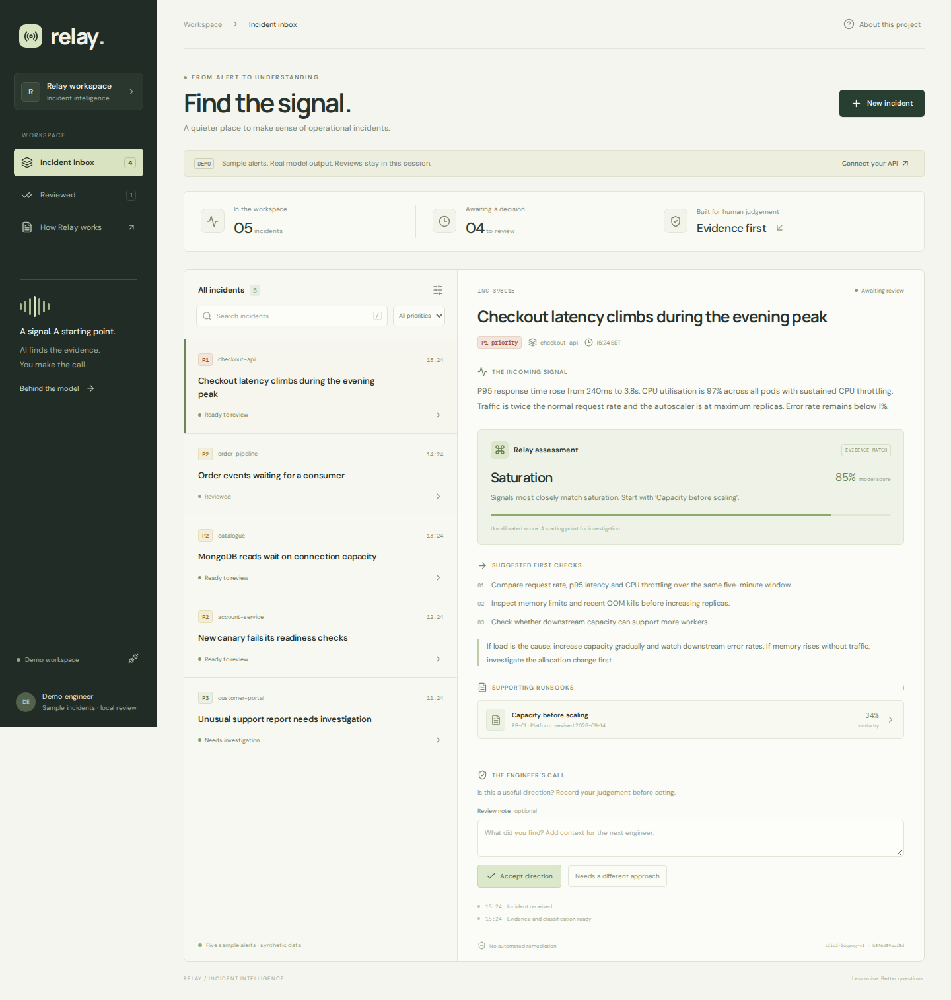

# Relay

An incident intelligence workbench. An engineer submits an operational alert; Relay classifies the symptoms, retrieves relevant runbooks and records the engineer's judgement. It offers a direction for investigation, with evidence attached.

The interesting part is what happens between the HTTP response and the review: durable publication, duplicate delivery, worker failure and concurrent decisions. Those are first-class behaviours here.



## Try the workbench

Python 3.12+, Node 22+ and Docker Compose v2 are the supported development tools.

**Browser demo — no accounts or backend required:**

```bash
cd frontend
npm ci
npm run dev
```

Open http://localhost:5173. Five synthetic incidents have real outputs from the Python model. Select an incident, expand a runbook, record a review, and try the support report that triggers abstention. Demo reviews last until reload.

**Complete event pipeline:**

```bash
cp .env.example .env
docker compose up -d --build --wait
docker compose exec api python scripts/seed.py
```

Open http://localhost:8080, choose **Connect your API**, and use `local-review-token`. Submit an incident and watch it move from queued to ready. Compose runs MongoDB, Redis, DRF, a Celery worker, one outbox scheduler and the Vue workbench. Local ports bind to loopback. The example credentials are for local use.

Send an alert from JavaScript:

```bash
RELAY_API_TOKEN=local-review-token node scripts/ingest.mjs docs/sample-alert.json
```

Stop with `docker compose down`; add `-v` to remove local database volumes.

## What is implemented

| Area | Implementation |
| --- | --- |
| Python AI | TF-IDF + logistic regression classifier; separate cosine retrieval; evidence checks and abstention |
| API | Django REST Framework, bearer authentication, input limits, idempotent submissions, optimistic review locking |
| Frontend | Vue 3 + TypeScript, responsive inbox, runbook inspection, human review, demo and connected modes |
| JavaScript | CLI producer with bounded retries and a stable request key; browser smoke test |
| MongoDB | Canonical incident, embedded outbox, review history and local worker leases |
| AWS | Container Lambda, API Gateway, EventBridge, SQS/DLQ and DynamoDB leases; SAM template |
| Google Cloud | Container recipe, Pub/Sub publisher and private Cloud Run push receiver; deployment guide |
| Containers | Docker Compose and Kubernetes API/worker/outbox manifests |
| Delivery & monitoring | Celery, JSON logs, CloudWatch alarms, optional Datadog APM setup |
| CI | GitHub Actions checks and container integration; CircleCI Python/frontend checks |

AWS is the primary cloud design. GCP and Kubernetes are deployment alternatives with their own delivery adapters. No cloud resources are created by the local demo.

## Why these choices

MongoDB holds an incident and its outgoing event in **one atomic document insert**. The dispatcher retries unpublished events. If it crashes after sending but before marking publication, it sends again. The worker lease and guarded incident update make that duplicate safe. Delivery is at least once.

DynamoDB provides conditional leases for the AWS worker; it does not duplicate the incident database. MongoDB provides the same contract locally and on GCP. Reviews compare the document version so two engineers cannot silently overwrite one another.

The model deliberately stays small and inspectable. There is no external model API or generated diagnosis. Runbook evidence is versioned, scores are labelled as uncalibrated, and the engineer remains responsible for any operational action.

## Development and checks

```bash
python3.12 -m venv .venv
.venv/bin/pip install -r requirements-dev.lock
.venv/bin/pip install --no-deps -e .
.venv/bin/ruff check backend scripts
.venv/bin/ruff format --check backend scripts
.venv/bin/pytest -q
.venv/bin/python scripts/evaluate.py
.venv/bin/python scripts/check_infra.py
.venv/bin/python scripts/seed.py --export
cd frontend
npm ci
npm test
npm run build
npx playwright install --with-deps chromium
# With npm run dev running in another terminal:
npm run smoke
# With the complete pipeline running, verify saved reviews through the browser:
RELAY_UI_URL=http://localhost:8080 npm run smoke:live
```

The tests cover submission conflicts, authentication, review races, classifier abstention, outbox retries, lease fencing, DynamoDB conditions, Lambda partial failures and the Pub/Sub receiver. The browser check exercises evidence, review, filtering and mobile layout. GitHub Actions also starts the real Compose pipeline and validates/builds the SAM stack.

Dependency locks are committed. Regenerate Python locks with `pip-compile pyproject.toml` using `--extra dev` or `--extra gcp` and the appropriate output file. Regenerate demo data after changing the model; CI checks that it matches.

## Read further

- [Architecture and failure handling](docs/architecture.md)
- [Model card and evaluation](docs/model-card.md)
- [API contract](docs/api.md)
- [AWS deployment](docs/aws.md)
- [Google Cloud deployment](docs/gcp.md)
- [Operations, Kubernetes and Datadog](docs/operations.md)
- [Verification record](docs/verification.md)

This is a single-workspace portfolio implementation. It has no tenant isolation, SSO, pagination beyond the latest 100 incidents, or production incident corpus. The 12-alert synthetic benchmark is a regression check, not evidence of production accuracy. Cloud deployment, load testing and container execution must be verified in the target environment before operational use.
