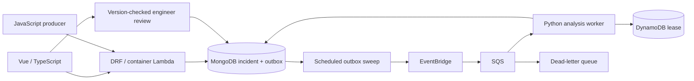

# Architecture

Locally the sweep is Celery beat and the transport is Redis/Celery. On GCP, a Cloud Run Job sweeps the outbox, publishes to Pub/Sub and delivers to a private Cloud Run receiver; its leases use MongoDB. The event contract is shared across transports.

## Submission and publication

A UUID `Idempotency-Key` becomes the Mongo document `_id`. The document includes the validated alert, its SHA-256 payload fingerprint, a generated incident ID, version, timeline and outgoing event. Mongo's unique primary key resolves simultaneous retries. Matching retries return the existing incident; differing payloads return 409.

Because the incident and outbox event share a document, acknowledging the incident cannot leave a separately written outbox behind. No multi-document transaction or replica set is needed for that boundary. Pending events are indexed and swept in batches of 100. Publication is acknowledged only after the transport succeeds. An EventBridge response with a failed entry also counts as failure.

There is no distributed transaction between MongoDB and a broker. A crash between publish and marking the outbox creates a duplicate. Concurrent sweepers may also publish duplicates. This is expected.

## Processing and reviews

The worker validates the envelope, acquires a 120-second lease and loads the incident. The lease owner is an opaque UUID. Mongo atomic updates or Dynamo conditional writes fence stale owners out of completion and release. An active lease raises a retriable error; a completed lease acknowledges a duplicate.

The analysis write requires `status=queued`. Even if a lease expires and two workers run, only one can transition the incident. A crash after that write but before lease completion is recovered by retrying: the next worker sees the ready/reviewed record and completes its lease without replacing it.

Reviews require `status=ready` and the version the engineer observed. A successful review increments the version. A concurrent or repeated review returns 409. The UI asks the user to refresh rather than guessing which decision should win.

The normal state machine is `queued → ready → reviewed`. Abstention is a ready analysis with `abstained=true`; the engineer can review the usefulness of the request for further investigation.

## Failure boundaries

| Failure | Behaviour |
| --- | --- |
| Mongo unavailable on submission | Request fails; no acknowledgement of durable acceptance |
| Broker unavailable | Incident remains queued; pending outbox retries on the next sweep |
| Sweep crashes after publish | Duplicate delivery; lease and incident guards absorb it |
| Worker fails | Lease released; Celery retry or SQS redelivery |
| Worker killed | Lease expires; redelivery can reclaim it |
| Stale lease owner finishes | Conditional update refuses to mark another owner's work done |
| Poison SQS event | Partial batch failure; five receives lead to DLQ |
| Concurrent review | One update wins; the other receives 409 |

SQS visibility is 360 seconds for a 60-second Lambda timeout. Local Celery uses late acknowledgement, prefetch one, retry jitter and a 60-second hard limit. A hard-killed local task can exhaust retries while a lease remains active; investigate queued records and republish their original events after expiry. Local Celery has no durable DLQ equivalent.

## Deliberate boundaries

MongoDB is the system of record. DynamoDB is an execution ledger. A NoSQL ORM would obscure the conditional writes; DRF handles HTTP concerns while a small repository makes storage behaviour explicit.

Events carry references and timestamps, not alert text or credentials. Completed ledger entries remain indefinitely in this version. Introducing retention requires a defined replay horizon: removing a ledger entry must not change the guarded incident write.

The API and model worker can scale independently. The outbox's batch cap and one-minute AWS sweep introduce latency and bound throughput; a measured backlog should guide the next iteration, not a claim of unlimited scaling. There is no automated remediation, event ordering dependency, multi-tenant authorization or automatic model retraining.
